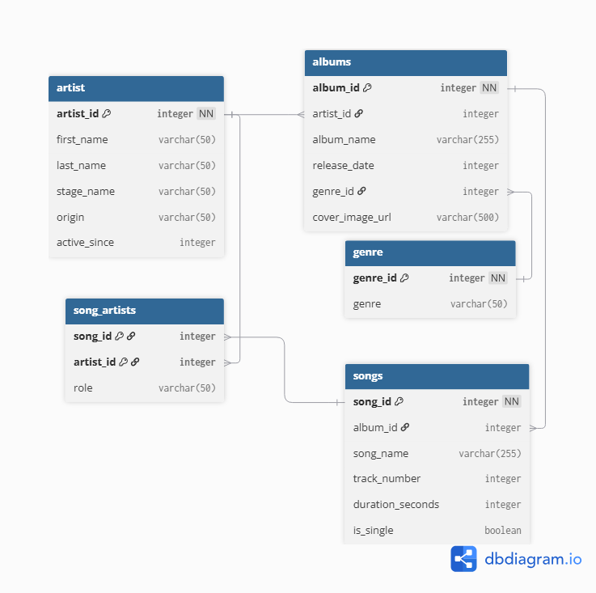

# SQL-inlämning — Diskografi

**Namn:** Max Svensson
**Artist:** J.Cole
**Datum:** 2026-10-13

---

## ER-diagram


## Albumomslag (URL:er från databasen)


---

## 1. Skapa databasen — CREATE TABLE

```sql
--- skriv din SQL-kod här ---

CREATE TABLE artist (
                        artist_id INTEGER NOT NULL,
                        first_name VARCHAR(50),
                        last_name VARCHAR(50),
                        stage_name VARCHAR(50),
                        origin VARCHAR(50),
                        active_since INTEGER,
                        PRIMARY KEY (artist_id)
);

CREATE TABLE genre (
                        genre_id INTEGER NOT NULL,
                        genre VARCHAR(50),
                        PRIMARY KEY (genre_id)
);

CREATE TABLE albums (
                        album_id INTEGER NOT NULL,
                        artist_id INTEGER,
                        album_name VARCHAR(255),
                        release_date INTEGER,
                        genre_id INTEGER,
                        cover_image_url VARCHAR(500),
                        PRIMARY KEY (album_id),
                        FOREIGN KEY (artist_id) REFERENCES artist(artist_id),
                        FOREIGN KEY (genre_id) REFERENCES genre(genre_id)
);

CREATE TABLE songs (
                        song_id INTEGER NOT NULL,
                        album_id INTEGER,
                        song_name VARCHAR(255),
                        track_number INTEGER,
                        duration_seconds INTEGER,
                        is_single BOOLEAN,
                        PRIMARY KEY (song_id),
                        FOREIGN KEY (album_id) REFERENCES albums(album_id)
);
-- VG many-to-many ---
CREATE TABLE song_artists (
                        song_id INTEGER NOT NULL,
                        artist_id INTEGER NOT NULL,
                        role VARCHAR(50),
                        PRIMARY KEY (song_id, artist_id),
                        FOREIGN KEY (song_id) REFERENCES songs(song_id),
                        FOREIGN KEY (artist_id) REFERENCES artist(artist_id)
);

```

---

## 2. Seeda med data — INSERT

```sql
--- skriv din SQL-kod här ---

INSERT INTO artist (artist_id, first_name, last_name, stage_name, origin, active_since)
VALUES (1, 'Jermaine', 'Cole', 'J. Cole', 'Fayetteville, North Carolina', 2007),
       (2, 'Oakley', 'Caesar-Su', 'Central Cee', 'London, United Kingdom', 2014);

INSERT INTO genre (genre_id, genre)
VALUES (1, 'Hip-Hop'),
       (2, 'East Coast Hip-Hop'),
       (3, 'Conscious Hip-Hop');

INSERT INTO albums (album_id, artist_id, album_name, release_date, genre_id, cover_image_url)
VALUES (1, 1, '2013 Forest Hills Drive', 2014, 1, 'https://upload.wikimedia.org/wikipedia/en/2/2a/2014ForestHillsDrive.jpg'),
       (2, 1, 'Might Delete Later', 2024, 2, 'https://upload.wikimedia.org/wikipedia/en/2/22/J._Cole_-_Might_Delete_Later.png'),
       (3, 1, 'Born Sinner', 2013, 3, 'https://upload.wikimedia.org/wikipedia/en/7/73/J._Cole_-_Born_Sinner_cover.png');

INSERT INTO songs (song_id, album_id, song_name, track_number, duration_seconds, is_single)
VALUES (1, 1, 'Wet Dreamz', 3, 239, TRUE),
       (2, 1, '03'' Adolescence', 4, 264, FALSE),
       (3, 1, 'Fire Squad', 6, 288, FALSE),
       (4, 1, 'No Role Modelz', 9, 292, TRUE),
       (5, 1, 'Love Yourz', 11, 211, FALSE),
       (6, 2, 'Huntin Wabbitz', 4, 163, FALSE),
       (7, 2, 'H.Y.B. (feat. Bas & Central Cee)', 5, 233, TRUE),
       (8, 2, 'Trae the Truth in Ibiza', 10, 255, FALSE),
       (9, 3, 'Power Trip (feat. Miguel)', 4, 241, TRUE),
       (10, 3, 'She Knows (feat. Amber Coffman & Cults)', 8, 297, TRUE),
       (11, 3, 'Rich Niggaz', 9, 276, FALSE);

--- Kopplar J. Cole och Central Cee till låten i song_artists ---
INSERT INTO song_artists (song_id, artist_id, role)
VALUES (7, 1, 'Main Artist'),  -- J. Cole
       (7, 2, 'Featured');     -- Central Cee

-- vi har many-to-many för att kunna slå ihop nycklar till en unik nyckel för att kunna separera vem som gör vad i en låt.
-- den länkar till både artist och låt id. den hindrar också att det blir dubbletter av samma artist eller låt. en artist kan ha flera låtar eller tvärtom
```

---

## 3. Söka — SELECT

```sql
--- query 1: Lista alla album, sorterade efter år ---

SELECT album_name, release_date
FROM albums
ORDER BY release_date;

--- query 2: Lista alla låtar på ett specifikt album ---

SELECT song_name
FROM songs
JOIN albums ON songs.album_id = albums.album_id
WHERE album_name = '2014 Forest Hills Drive';

--SELECT song_name
--FROM songs
--WHERE songs.album_id = '1';


--- query 3: Antal låtar per album ---

SELECT album_name, COUNT(song_name) AS total_songs
FROM songs
JOIN albums ON songs.album_id = albums.album_id
GROUP BY album_name;

--- query 4: Längsta låten ---

SELECT song_name, duration_seconds
FROM songs
ORDER BY duration_seconds DESC
LIMIT 1;

--- query 5: Alla låtar sorterade alfabetiskt ---

SELECT song_name
FROM songs
ORDER BY song_name;

```

---

## 4. Lägg till en ny rad — INSERT

```sql
--- lägg till ett nytt album eller en ny låt ---

INSERT INTO songs (song_id, album_id, song_name, track_number, duration_seconds, is_single)
VALUES (12, NULL, 'Port Antonio', 1, 307, TRUE),
       (13, 1, 'A Tale of 2 Citiez', 5, 269, TRUE);
```

---

## 5. Ta bort en rad — DELETE

```sql
--- ta bort en rad ur valfri tabell ---

DELETE FROM songs WHERE song_name = 'Huntin Wabbitz';

```

---

## 6. Uppdatera en rad — UPDATE

```sql
--- uppdatera minst en rad i valfri tabell ---

UPDATE albums
SET album_name = '2014 Forest Hills Drive'
WHERE album_id = 1;

```

---

## 7. VG-queries (om du siktar på VG)

```sql
--- query 6: Snittlängd på låtar per album ---

SELECT album_name, ROUND(AVG(duration_seconds),1) AS Snittlängd --round för att ta bort extra decimaler
FROM songs
JOIN albums ON songs.album_id = albums.album_id
GROUP BY album_name;

--- query 7: Albumet med flest låtar ---

SELECT album_name, COUNT(song_name) AS total_songs
FROM songs
JOIN albums ON songs.album_id = albums.album_id
GROUP BY album_name
ORDER BY total_songs DESC
LIMIT 1;

--- query 8: Alla låtar längre än 4 minuter (240 sekunder), med albumtitel ---

SELECT song_name, album_name, duration_seconds FROM songs
JOIN albums ON songs.album_id = albums.album_id
WHERE duration_seconds > 240;

```

